# Architecture — Learning-Samples

This repo is **not one system**. It is a `Learning.Projects.sln` grab-bag of small,
independent .NET samples, each exploring one concept in isolation. The diagram below
groups them honestly, by sample, rather than inventing a data flow that does not
exist between unrelated folders. Only one real data flow crosses project boundaries:
`SampleApi -> DataAccess -> UserDB`.

## Diagram

```mermaid
flowchart TB
  subgraph s1["Configuration sample"]
    Configurations["Configurations<br/>binds JSON / env / CLI / user-secrets config to AppSettings"]
  end

  subgraph s2["Exception-handling sample"]
    ConsoleUI["ConsoleUI<br/>global try-catch demo, console app"]
    ExceptionsLibrary["ExceptionsLibrary<br/>nested try-catch-rethrow logic - build currently broken, see gotchas"]
    ConsoleUI --> ExceptionsLibrary
  end

  subgraph s3["Dependency-injection samples - 3 independent takes"]
    DependencyInjection["DependencyInjection<br/>manual constructor/setter/interface injection, no container"]
    DependencyInjectionExample1["DependencyInjection.Example1<br/>DI container plus a BackgroundService worker"]
    DependencyInjection1["DependencyInjection1<br/>bare ServiceCollection stub, nothing registered"]
  end

  subgraph s4["Minimal API + data-access sample"]
    SampleApi["SampleApi - Template.API<br/>users / courses / error / health minimal-API endpoints"]
    DataAccess["DataAccess - User.DataAccess<br/>Dapper plus SqlClient wrapper, class library"]
    UserDB[("UserDB<br/>SQL Server database project, dbo.spUser_ stored procs")]
    SampleApi --> DataAccess --> UserDB
  end

  subgraph s5["Blazor WebAssembly sample - duplicate pair"]
    TestUI["TestUI<br/>Blazor WASM host"]
    TesteUI["TesteUI<br/>byte-identical duplicate of TestUI, imports the TestUI namespace"]
  end

  subgraph s6["Unloaded - orphaned, not in the .sln"]
    UnloadedAPI["Unloaded/API<br/>earlier minimal-API iteration, net9.0"]
    UnloadedSampleUI["Unloaded/SampleUI<br/>earlier Blazor WASM iteration, net9.0"]
  end
```

Each subgraph is independent. The only inter-project edges anywhere in the repo are
`ConsoleUI -> ExceptionsLibrary` and `SampleApi -> DataAccess -> UserDB`; every other
folder is self-contained with no calls to or from another sample.

## Components

| Component | Responsibility |
|---|---|
| `Configuration.cs` (repo root) | Unused scaffold stub (`Class1`, empty constructor) — not wired into any sample |
| `Configurations` | Binds configuration from JSON files, environment variables, command-line args, an in-memory source, and user secrets onto a strongly-typed `AppSettings`; prints the resolved config source chain |
| `ConsoleUI` | Demonstrates a top-level global exception handler around a call chain that intentionally throws |
| `ExceptionsLibrary` | `DemoCode.GrandparentMethod` shows nested try/catch/rethrow with a preserved inner exception. **Currently fails to compile** — see Operational notes |
| `DependencyInjection` | Hand-rolled constructor, setter, and interface injection with no DI container, to contrast against the container-based samples |
| `DependencyInjection.Example1` | Registers a typed interface (`IMessageWriter`) and a `BackgroundService` worker with `Microsoft.Extensions.DependencyInjection` |
| `DependencyInjection1` | Smallest possible DI sample — constructs a bare `ServiceCollection` and stops there |
| `SampleApi` (`Template.API`) | ASP.NET Core minimal API: `/users` (CRUD via `DataAccess`), `/courses` (in-memory sample data), `/error/{code}`, `/health*` (4 custom health checks + health-check UI), Swagger/OpenAPI, permissive CORS |
| `DataAccess` (`User.DataAccess`) | Class library wrapping Dapper + `Microsoft.Data.SqlClient`; `SqlDataAccess` executes stored procedures, `UserData` calls `dbo.spUser_*` for CRUD |
| `UserDB` | SQL Server database project (`.sqlproj`) defining the `dbo.spUser_*` stored procedures and tables `DataAccess` calls into |
| `TestUI` / `TesteUI` | Blazor WebAssembly hosting sample; the two folders are a byte-identical duplicate pair, not two distinct designs |
| `Unloaded/API` | Earlier iteration of the minimal-API sample (net9.0). Not part of `Learning.Projects.sln` |
| `Unloaded/SampleUI` | Earlier iteration of the Blazor WASM sample (net9.0). Not part of `Learning.Projects.sln` |

## Data-flow summary

There is no data flow spanning the whole repo — most samples are single-process
console apps that never exchange data with another folder. The one real
cross-project flow: an HTTP request into `SampleApi`'s `/users` endpoints
(`SampleApi/Endpoints/UserEndPoints.cs`) is handled by `UserData`
(`DataAccess/Data/UserData.cs`), which calls `ISqlDataAccess.LoadData`/`SaveData`
(`DataAccess/DbAccess/SqlDataAccess.cs`) to open a `SqlConnection` and execute a
`dbo.spUser_*` stored procedure defined in the `UserDB` database project, using
Dapper for the object mapping. `SampleApi`'s `/courses` endpoints, by contrast, read
from an in-memory list (`SampleApi/Data/CourseData.cs`) and never touch `DataAccess`
or `UserDB`.

## External integration points

| Integration | What it's for |
|---|---|
| SQL Server (`UserDB`) | The only external system this repo talks to. `SampleApi`'s `/users` endpoints read/write through `DataAccess` (Dapper + `Microsoft.Data.SqlClient`) into stored procedures defined in the `UserDB` SQL Server database project. The connection string name is `ConnectionStrings:Default` — see README § Configuration (name only, no value recorded). |

No other sample in this repo makes an outbound call to any external system, service,
queue, or API.

## Operational notes / gotchas

- Ensure that user secrets are not checked into version control.
- Configuration files should be named correctly to match the environment (e.g.,
  `appsettings.Development.json`).
- Dependency-injection setup requires careful management of service lifetimes and
  scopes.
- `ExceptionsLibrary/DemoCode.cs` has a stray extra closing brace after the class
  body (verified with `dotnet build`: `DemoCode.cs(55,1): error CS1022`). It does not
  compile as of the distilled commit, and `ConsoleUI` — which references it — won't
  build until it's fixed.

## Deeper docs

No `.ai/adr/` directory exists in this repo; there are no architecture-decision
records to point to. `.ai/CONTEXT.md` carries the rest of this repo's documentation.

---
schema_version: 1.0.0
distilled_from_sha: 30251b9140f8181bc9cb580fcd774ca6542d4712
verified_sha: 30251b9140f8181bc9cb580fcd774ca6542d4712
verified_at: 2026-08-16T18:38:11Z
